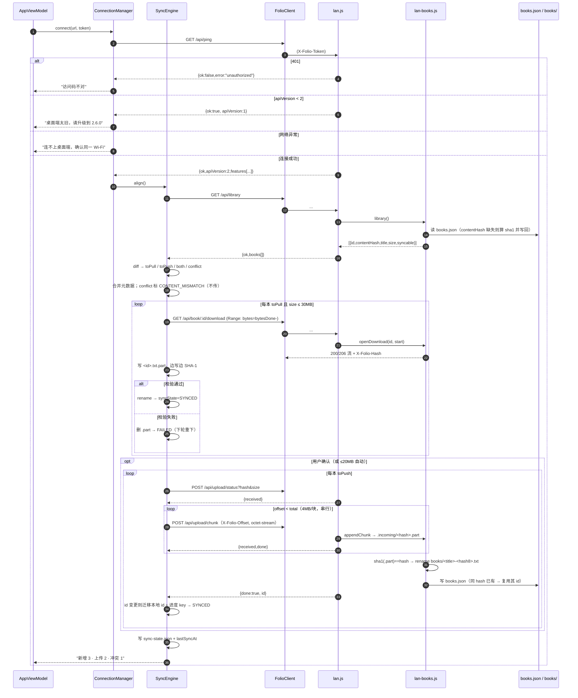
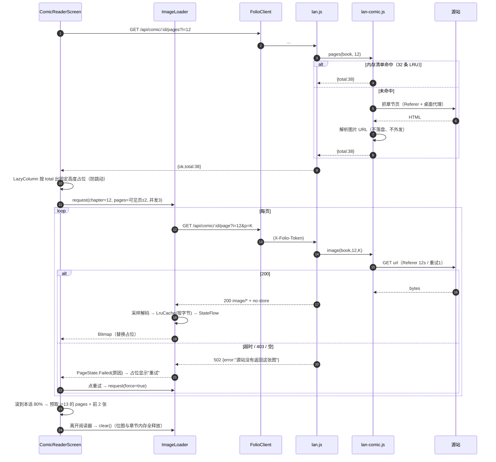

# 架构设计 · Android 3.0 独立阅读器 + 桌面端 2.6.0 配套

> 基线：桌面端 2.5.0（Electron 30 / Node 18） + Android 2.5.0（Kotlin 2.0 / Compose）
> 目标：桌面端 **2.6.0**、Android **3.0.0**，双端同期发布
> 需求基线：`docs/prd-android-v3.md`（决策已由产品负责人拍板，本文不推翻）

**一句话方案**：桌面端把「书架清单 / 整文件收发 / 漫画取图」三件事补成接口；Android 把远端书架从"真相"降级为"元数据提示"，本地 `books.json` 成为书架真相，同步引擎只做「hash 差集 + 整文件搬运」。

---

## 1. 实现方案与选型

### 1.1 整文件同步：分块续传（选定），不做整本重传

| 项 | 取值 | 说明 |
| --- | --- | --- |
| 块大小 | **4 MiB** | 30MB 上限 → 最多 8 块；单请求体 < 6MB，不必抬高全局 `MAX_BODY`(512KB) |
| 会话主键 | `sha1`（40 hex 小写） | 与服务端最终内容一一对应，天然幂等 |
| 临时文件 | `books/.incoming/<hash>.part` | 同盘 `renameSync` 原子落盘，不会出现半个 `books/*.txt` |
| 续传 | `GET /api/upload/status?hash&size` → `received` | 客户端从 `received` 续传；不连续一律 409 + 回传 `received` |
| 校验 | commit 时服务端重算 `.part` 的 sha1 | 不等 → 删 `.part` + 422，客户端重传整本 |
| 下载续传 | `Range: bytes=N-` → 206（仅单区间） | 手机侧留 `<id>.txt.part`，`bytesDone` 记进 sync-state |
| 并发 | **串行单块** | 局域网单连接已近带宽上限；串行保证 offset 单调、代码少一半状态 |

**为什么选续传而不是整本重传**：30MB 经家用 Wi-Fi（手机→路由器→PC）实测常在 3–8MB/s，一次 4–10s；而锁屏、切后台、路由器抖动都会断。整本重传让用户"重等一遍"，续传只多一个 status 接口 + 一个 offset 参数（≈60 行）。**不做多块并发**是唯一让步：复杂度换不来速度。

**幂等三件套**：① `.part` 只按 offset 追加；② 同 offset 重放返回 409 让客户端先 status 再续；③ commit 后 `books.json` 的 id 由 hash 推导（`sha1-<hash>`），同内容重复上传只会命中已有条目。

### 1.2 清单差集算法（只有 Android 发起，桌面端无状态）

- **桌面端算**：`/api/library` 返回全量书架（含云端书），`kind=local` 且有副本的条目带 `contentHash`（缺失时懒补齐：sha1 文件字节 → 写回 `books.json`），并带 `syncable`（`kind=local` 且 `size ≤ 30MB`）。
- **Android 算**：以 `BookStore` 中 `hasLocalFile=true` 的书建 `hash → book` 索引。差集只在 Android 端完成，桌面端不存任何"已同步"状态，因此不存在双端状态漂移。
- **谁发起**：Android。触发点 = 连接成功 / 回前台 / 用户点「立即同步」。
- **差集结果四分类**：`toPull = remoteHashes - localHashes`、`toPush = localHashes - remoteHashes`、`both`（只换元数据）、`conflict`（`titleKey` 相同但 hash 不同 → 标 `CONTENT_MISMATCH`，**不传**）。
- **`titleKey`** = `title.trim()` → 全角括号转半角 → 去尾部 `(1)/(2)/ 副本/（数字）` → 压缩空白 → `lowercase()`。

### 1.3 漫画取图：桌面端代理，**按页索引**取图而非按 URL 取图

- 手机只拿 `{total}`，**不拿源站 URL**：既避免手机直连 403，也遵守现有「章节地址不出机器」原则，同时**根除 SSRF**（不给手机一个任意 URL 代理口）。
- 请求 `GET /api/comic/:id/page?i=<话>&p=<页>`；服务端用自己内存里的清单（由 `/pages` 或桌面端 `cloud:chapter-images` 产出）解析出源站 URL，用 `fetchCoverResponse(url, {referer, timeout:12000, retries:1})` 流式转发，**不复用 `cacheCover`**（那会把漫画页写进封面缓存目录）。
- 失败策略：单页失败只 502 该页，绝不整话失败；手机端占位 + 重试。桌面端对 `(bookId, 话)` 清单做内存 Map 缓存（上限 32 条 LRU），图片字节**不缓存、不落盘**。
- 超时：桌面取图 12s / 重试 1 次；手机 `readTimeout` 15s、`connectTimeout` 5s。

### 1.4 Android 图片加载：自研，不引 Coil

| 维度 | Coil 2/3 | 自研（选定） |
| --- | --- | --- |
| 网络层 | 依赖 OkHttp（≈1.2–1.5MB APK 增量） | 复用现有 `HttpURLConnection` 包装，0 增量 |
| 鉴权 | 需自定义 Fetcher/Interceptor 注入 `X-Folio-Token` | `FolioClient` 直接带头 |
| 零缓存自证 | 需 `diskCache(null)`，磁盘缓存关闭靠配置正确 | 只有 `LruCache<Key,Bitmap>`，`size()` 可在设置页直读上报 |
| 请求模型 | 按 URL + 内部缓存键，我们要按 `(话,页)` | 天然按 `(chapter,page)` |

**结论：自研**。`ImageLoader` 组成：目标尺寸 = `min(源宽, 屏宽×2)`（保证 3x 放大可读又不炸内存）；`inJustDecodeBounds` 算 `inSampleSize`；缓存上限 = `min(96MB, maxMemory/8)` 按字节计；同 key 请求用 `Deferred` 去重；`Semaphore(3)` 并发；离开阅读器 `clear()` + `onTrimMemory` 响应。

### 1.5 Android 数据层去留

| 现有 | 处置 | 替代 |
| --- | --- | --- |
| `SettingsStore` | **保留**，改字段 | 删 `autoCache`；加 `autoTransferUnder20MB`、`wifiOnly`、`hideRemoteWhenOffline`、`connectionState`、`lastHealthAt` |
| `LibraryStore`(115) | **删除** | `BookStore` / `ProgressStore` / `SyncStateStore` 三个薄 Store（写频率差异大，分文件避免高频进度写污染 books.json） |
| `OfflineStore`(163) | **删除** | `BookFileStore`（本机正文 `books/<id>.txt`）+ `ChapterMemoryCache`（云端 3 章，内存）+ `ImageLoader`（内存） |
| `SyncManager`(181) | **删除** | `SyncEngine`（差集+传输编排）+ `ConnectionManager`（连接/健康检查）+ `ProgressSync`（合并/补写） |
| `work/SyncWorker` | **删除** | 无后台任务；只在连接成功 / 回前台 / 手动点按触发 |
| `core/ChapterFallback` | **删除** | 不做降级 |
| `net/LanDiscovery` | **保留**，微调 | 点按一次性广播，5s 收集窗口 |

---

## 2. HTTP 接口表（桌面端 2.6.0）

**统一**：所有 `/api/*` 经现有 `authorized()`（`X-Folio-Token` 头或 Cookie）；响应统一 `Cache-Control: no-store`；错误体统一 `{ok:false, error:"<中文文案>"}`。

| 方法 | 路径 | 参数 | 成功响应 | 鉴权/限制 |
| --- | --- | --- | --- | --- |
| GET | `/api/ping` | — | `{ok,port,version,apiVersion:2,features:["library","upload","download","range","comic"]}` | 需 token；`apiVersion<2` 时手机提示"桌面端太旧" |
| GET | `/api/library` | — | `{ok,apiVersion:2,now,books:[{id,contentHash?,title,author,size,type,kind,syncable,syncableReason?,cover?}]}` | 需 token；最多 2000 本，超出 `truncated:true` |
| GET | `/api/book/:id/download` | 头 `Range: bytes=N-`（可选） | 200/206 字节流；头 `X-Folio-Hash`、`X-Folio-Size`、`Accept-Ranges: bytes`、`Content-Disposition` | 需 token；`size>30MB`→413；非 local→404/409；`N>=size`→416 |
| GET | `/api/upload/status` | `hash`(40hex) `size` | `{ok,hash,received,done}` | 需 token；`size>30MB`→413；写关闭→403 |
| POST | `/api/upload/chunk` | 头 `X-Folio-Hash`、`X-Folio-Offset`、`X-Folio-Total`、`X-Folio-Name`(encodeURIComponent)；body `application/octet-stream` | `{ok,received,done:false}` / 完成 `{ok,received,done:true,id,title,created}` | 需 token；body ≤6MB→否则 413；offset 不连续→409 `{received}`；hash 校验失败→422 |
| DELETE | `/api/upload/:hash` | — | `{ok:true}` | 需 token；失败清理用 |
| GET | `/api/comic/:id/pages` | `i`(话序号) | `{ok,i,total,fromCache}` —— **不含源站 URL** | 需 token；非 `type=2`→400；云端未接入→501；解析失败→502 |
| GET | `/api/comic/:id/page` | `i`(话) `p`(页，0 基) | 200 `image/*` 字节 + `X-Folio-Page: K/Total` | 需 token；`p` 越界→400 `{total}`；单页 >6MB→413；源站失败→502 |
| GET | `/api/state` | — | 原样 + `server.apiVersion:2` | **仅用于进度对齐**，手机不再用它当书架真相 |
| POST | `/api/progress` | 原样 | 原样 | 不变（`mergeProgressEntry` 新者赢 + 浅合并） |
| GET | `/api/book/:id` `/api/toc` `/api/chapter` `/api/cover` `/api/events` | 原样 | 原样 | 保留给旧客户端与网页面板 |

**错误码语义**：`400` 参数不合法 · `401` 访问码不对 · `403` 桌面端关闭写入 · `404` 书/页不存在 · `409` offset 不连续 · `413` 超大小上限 · `416` Range 越界 · `422` hash 校验失败 · `500` 服务端读写失败 · `501` 能力未接入 · `502` 源站抓取失败。

**上传完成后的副作用**：`writeJson(books.json)` → `publish('books',{reason:'upload',id})`（SSE 给网页面板）+ 主进程 `broadcast('lan:books',{id})`（渲染层刷新书架）。

---

## 3. 数据结构

### 3.1 桌面端 `books.json` 新增字段

| 字段 | 类型 | 说明 |
| --- | --- | --- |
| `contentHash` | `string`(40hex) | `sha1(UTF-8 正文字节)`；云端书无此字段 |
| `size` | `number` | 正文副本字节数（`fs.statSync().size`），已存在但部分书缺失，顺手补 |
| `syncedFrom` | `"android"?` | 手机端上传来的书，仅做展示 |
| `contentVersion` | `number` | 每次正文被覆盖 +1，用于客户端缓存失效（默认 1） |

**上传落盘规则**：`id = "sha1-" + hash`；`filePath = books/<safeBase(title)>-<hash 前 8>.txt`；若 `books.json` 已有同 hash 但不同 id 的书 → **复用已有 id**（响应回 `id`，手机据此迁移本地 id 与进度 key）；同名不同 hash → 文件名带 hash 后缀并存（`writeBookCopy` 已有该逻辑）。

**旧数据兼容**：读取时不改任何老字段；`contentHash` 缺失只在 `/api/library` 或上传比对时**懒补齐**并原子写回，写失败只记日志不阻断；`content` 内联老数据沿用现有 `migrateInlineBookContent`。

### 3.2 Android 本地结构

```
filesDir/
  library/books.json         # List<LocalBook>
  library/progress.json      # { id: ProgressEntry }
  library/pending.json       # { ids: [...] }
  library/sync-state.json    # { id: {state,lastError,at,bytesDone,totalBytes} }
  books/<id>.txt             # 本机书正文（UTF-8）
  books/<id>.txt.part        # 下载中临时文件，校验后原子改名
```

```kotlin
enum class Origin { LOCAL, DESKTOP }
enum class BookType(val wire: Int) { NOVEL(0), COMIC(2) }
enum class SyncState(val wire: String) {
    NOT_SYNCED("notSynced"), TRANSFERRING("transferring"), SYNCED("synced"),
    FAILED("failed"), CONTENT_MISMATCH("contentMismatch"), EXCLUDED("excluded")
}

data class LocalBook(
    val id: String,            // 本机书 = "sha1-"+contentHash；桌面书 = 桌面 id
    val title: String, val author: String? = null,
    val origin: Origin, val remoteKind: String? = null,  // "local" / "cloud"
    val type: BookType = BookType.NOVEL,
    val contentHash: String? = null,
    val size: Long = 0L, val encoding: String? = null,    // utf-8 / gbk / utf-16le / utf-16be
    val hasLocalFile: Boolean = false,
    val cover: String? = null, val remoteId: String? = null,
    val addedAt: Long = 0L, val lastReadAt: Long = 0L,
    val syncState: SyncState = SyncState.NOT_SYNCED,
)
```

**状态机**

| 迁移 | 触发 | 落点 |
| --- | --- | --- |
| `NOT_SYNCED → TRANSFERRING` | 开始下载/上传 | 写 `bytesDone=0` |
| `TRANSFERRING → SYNCED` | hash 校验通过 + 原子改名 + 元数据落盘 | 清 `lastError` |
| `TRANSFERRING → FAILED` | 网络断 / 空间不足 / hash 不符 | 留着 `.part` 与 `bytesDone` 以便续传 |
| `FAILED → TRANSFERRING` | 用户重试或下次连接 | 先 `upload/status` 或 Range 探测 |
| `NOT_SYNCED/FAILED → EXCLUDED` | `size > 30MB` 或 `remoteKind==cloud` | 永不参与同步，书架标"仅本机可读" |
| `any → CONTENT_MISMATCH` | 差集发现 `titleKey` 相同、hash 不同 | 不传，等用户选（覆盖需二次确认 + 先备份 `.bak`） |

---

## 4. 关键时序图

### 4.1 连接后清单对齐 + 双向整文件传输（含冲突分支）



### 4.2 云端漫画取图（预取 + 失败重试）



---

## 5. 文件清单

### 桌面端（2.6.0）

| 动作 | 路径 | 职责 |
| --- | --- | --- |
| 新增 | `electron/bookfile.js` | 文件 sha1、原子写、`.incoming` 会话（status/append/commit/discard）、contentHash 懒补齐 |
| 新增 | `electron/lan-books.js` | `library()` / `openDownload()` / `uploadStatus()` / `appendChunk()` / `commitUpload()` / `discardUpload()` |
| 新增 | `electron/lan-comic.js` | 漫画清单内存 LRU + 按页转发源站字节（不落盘） |
| 修改 | `electron/lan.js` | 新增 `readBodyBuffer()` 与 9 条路由；`/api/ping` 加 `apiVersion/features`；`MAX_TRANSFER/MAX_CHUNK/MAX_IMAGE` |
| 修改 | `electron/main.js` | `ensureLanService()` 注入 `books/comic` 适配器；上传完成 `broadcast('lan:books')`；启动时后台补齐 contentHash |
| 修改 | `package.json` `package-lock.json` `README.md` | 版本 2.6.0（`verify-release.mjs` 会校 lockfile 与 README） |
| 修改 | `tools/_lan-fixture.mjs` | 夹具支持上传/下载/漫画（本地假图，不打外网） |
| 新增 | `tools/_lan-sync-check.mjs` | 自查：上传 30MB 往返 + 断点 + Range + 冲突 |
| 修改 | `CHANGELOG.md` | 2.6.0 条目 |

### Android（3.0.0）

| 动作 | 路径 | 职责 |
| --- | --- | --- |
| 新增 | `core/BookImporter.kt` | SAF 多选导入 → 解码 → sha1 → 去重 → 落盘 → 元数据 |
| 新增 | `core/TextDecoder.kt` | BOM/UTF-8 校验/GBK 兜底，顺序与桌面 `decodeText` 一致 |
| 新增 | `core/HashUtils.kt` | 流式 sha1（文件、输入流、进度回调） |
| 新增 | `core/ChapterMemoryCache.kt` | 云端 3 章 LRU（纯内存，`clear()` 可断言） |
| 新增 | `core/ImageLoader.kt` | LruCache<PageKey,Bitmap>、采样解码、并发去重、abort、`sizeBytes()` |
| 新增 | `data/BookStore.kt` / `ProgressStore.kt` / `SyncStateStore.kt` | 三份本地 json 读写（原子 tmp+rename） |
| 新增 | `data/BookFileStore.kt` | `books/<id>.txt` 与 `.part` 管理 |
| 新增 | `data/Migration.kt` | 迁旧 `progress.json`；删 `offline/` 与旧 `library/` 冗余 |
| 新增 | `data/SyncEngine.kt` | 差集/冲突/上下行编排/空间预检/续传 |
| 新增 | `data/ConnectionManager.kt` | 连接状态、错误三分类、健康检查、token 变更标记需重连 |
| 新增 | `data/CloudChapterSource.kt` | 云端小说按章读取（只进内存） |
| 修改 | `core/Models.kt` | `LocalBook/Origin/BookType/SyncState` + 编解码（保留 `ProgressEntry` 字段名） |
| 修改 | `net/FolioClient.kt` | 新增 `library/download/upload*/comicPages/comicPage`，能力位与流式读写 |
| 修改 | `net/LanDiscovery.kt` | 一次性广播 + 5s 窗口 + 可取消 |
| 修改 | `ui/AppViewModel.kt` `ui/UiState.kt` | 新状态模型（连接/同步/分区/角标）与动作 |
| 修改 | `ui/ShelfScreen.kt` | 分区、灰态、角标、筛选、长按删除、导入入口、未连接横幅 |
| 修改 | `ui/ReaderScreen.kt` | 段落 LazyColumn、排版弹层、目录抽屉、云端按章 |
| 修改 | `ui/SettingsScreen.kt` | 连接/同步/排版/存储（缓存占用恒 0 自证）/关于诊断 |
| 修改 | `MainActivity.kt` `FolioApp.kt` | 新增 `comic` / `sync` 路由；依赖容器重建 |
| 新增 | `ui/ComicReaderScreen.kt` `ui/SyncStatusScreen.kt` `ui/reader/*.kt` | 漫画阅读、同步状态页、排版/目录子组件 |
| 修改 | `app/build.gradle.kts` | `versionName 3.0.0` `versionCode 2`；删 `work-runtime-ktx` |
| 删除 | `data/LibraryStore.kt` `data/OfflineStore.kt` `data/SyncManager.kt` `work/SyncWorker.kt` `core/ChapterFallback.kt` | 见 §1.5 |
| 删除 | `test/.../ChapterFallbackTest.kt` | 能力已下线 |
| 新增 | `test/.../TextDecoderTest.kt` `HashUtilsTest.kt` `BookImporterTest.kt` `SyncDiffTest.kt` `ComicPageKeyTest.kt` | 新能力单测 |
| 修改 | `test/.../LanIntegrationTest.kt` `ProgressCodecTest.kt` | 改走新接口；删缓存/退章断言 |

---

## 6. 任务列表（按实现顺序）

| ID | 依赖 | 任务 | 改哪里 / 做成什么样 / 怎么验 |
| --- | --- | --- | --- |
| T01 | — | 桌面端基础：版本号 + 文件哈希与上传会话模块 | `electron/bookfile.js`：`fileSha1(path)`、`atomicWrite()`、`incomingPath(hash)`、`appendChunk(hash,offset,buf)`（offset≠size→`{gap,received}`）、`commit(hash)`（重算 sha1→rename）、`discard(hash)`、`ensureContentHash(book)`。`package.json`/lock/README→2.6.0。验：`node -e` 对夹具目录跑 append+commit，断言 sha1 一致、`.part` 消失 |
| T02 | #1 | 桌面端清单 + 整文件下载 | `electron/lan-books.js` + `lan.js`：`GET /api/library`（全量、`syncable/syncableReason`、懒补齐并写回 books.json）、`GET /api/book/:id/download`（`createReadStream({start})`、206 + `Content-Range`、`X-Folio-Hash`、30MB→413、`N>=size`→416）、`/api/ping` 加 `apiVersion:2`+`features`。验：`tools/_lan-sync-check.mjs` 下载 12MB 与 30MB 书，`curl -H 'Range: bytes=100-'` 拿 206 |
| T03 | #1 | 桌面端分块上传 | `lan.js` 加 `readBodyBuffer(req, limit=6MB)`；`GET /api/upload/status`、`POST /api/upload/chunk`（octet-stream 追加、409 回 `received`、commit 后写 books.json 并复用同 hash 已有 id）、`DELETE /api/upload/:hash`；完成后 `publish('books')` + `broadcast('lan:books')`。验：脚本上传 30MB（分 8 块）、中途删 `.part` 重传、故意改一字节断言 422 |
| T04 | #1 | 桌面端漫画代理 | `electron/lan-comic.js`：清单内存 LRU(32) + `image()` 用 `fetchCoverResponse`（12s/重试1）转发；`GET /api/comic/:id/pages`（只回 `total`）、`GET /api/comic/:id/page`（越界 400 带 `total`、>6MB 413、源站失败 502）；`main.js` 注入 `cloud.comicImages`。验：夹具用本地 http 假图源，跑通清单 + 首页字节，`Content-Length` 对得上 |
| T05 | #2,#3,#4 | 桌面端夹具与自查脚本 | `tools/_lan-fixture.mjs` 支持上传/下载/漫画假源；`tools/_lan-sync-check.mjs` 一条命令跑全流程并退出码汇报。验：`node tools/_lan-sync-check.mjs /tmp/x` 全绿；`npm run check` 仍通过 |
| T06 | — | Android 工程基线 | `app/build.gradle.kts`（3.0.0 / versionCode 2 / 删 `work-runtime-ktx`）、删 `work/SyncWorker.kt`、`FolioApp.kt` 容器换新 Store 占位。验：`gradle :app:assembleDebug` 通过；App 启动不崩 |
| T07 | #6 | Android 模型 + 哈希 | `core/Models.kt` 重写（`LocalBook/Origin/BookType/SyncState` + `toJson/fromJson`，`ProgressEntry` 字段名一字不改）、`core/HashUtils.kt`、`core/Json` 原子写工具。验：新 `HashUtilsTest`（已知字节的 sha1）、`ProgressCodecTest` 原样通过 |
| T08 | #7 | Android 编码识别与导入 | `core/TextDecoder.kt`（UTF-16 BOM→UTF-8 BOM→严格 UTF-8→GBK，顺序同桌面）、`core/BookImporter.kt`（SHA-1 流式、`id="sha1-"+hash`、命中已有 hash 返回 `Duplicate(existingId)`）、`data/BookFileStore.kt`。验：`TextDecoderTest` 用 GBK/UTF-16LE/UTF-8-BOM 三份字节断言；导入同一文件两次第二次为 `Duplicate` |
| T09 | #7 | Android 三份本地存储 + 迁移 | `data/BookStore.kt`/`ProgressStore.kt`/`SyncStateStore.kt`、`data/Migration.kt`（迁旧 progress.json，删 `offline/`），删 `LibraryStore.kt`。验：单测写读往返；启动日志出现"已清理旧缓存 N 字节"；`offline/` 目录不再生成 |
| T10 | #7 | Android 协议客户端 | `net/FolioClient.kt` 加 `library()`、`downloadBook(file,offset)`（流式写 + sha1）、`uploadStatus()`、`uploadChunk(file,offset,len)`（`setFixedLengthStreamingMode` + `FileChannel` 流式）、`comicPages()`、`comicPage()`、`capabilities()`。验：JVM 单测起 T05 夹具跑通上传/下载/漫画 |
| T11 | #9,#10 | Android 同步引擎 | `data/SyncEngine.kt`：差集四分类、`titleKey` 冲突判定、`StatFs` 预检（剩余 < size×1.2 直接拒）、串行续传、id 归并（响应 id≠本地 id → 迁移 books/progress 键）、完成写 sync-state。验：`SyncDiffTest` 覆盖 4 类 + 冲突；真机与桌面互传 20MB |
| T12 | #10 | Android 连接管理 + 设置字段 | `data/ConnectionManager.kt`（三分类错误文案、`apiVersion<2` 提示升级、token 变更→` NEED_RECONNECT`、回前台一次健康检查）、`net/LanDiscovery.kt` 一次性广播、`SettingsStore` 字段改。验：改错 token 提示"访问码不对"、拔网线提示"连不上桌面端"、搜索 5s 出列表 |
| T13 | #9,#10 | 云端小说零缓存 | `core/ChapterMemoryCache.kt`（3 章 LRU）、`data/CloudChapterSource.kt`、删 `OfflineStore.kt`/`ChapterFallback.kt`。验：读 3 章后 `filesDir` 与 `cacheDir` 文件数不变（单测断言）；断网翻章抛"连接已断开" |
| T14 | #10 | 漫画内存图片加载器 | `core/ImageLoader.kt`（`LruCache` 按字节、`inSampleSize`、`Semaphore(3)`、同 key `Deferred` 去重、`clear()`、`sizeBytes()`）、`core/SampleSize.kt`（纯函数可测）。验：`ComicPageKeyTest`/采样单测；真机连续翻 60 页无 OOM，设置页缓存占用恒 0 |
| T15 | #9,#11,#12 | 书架 UI 与状态 | `ui/UiState.kt`、`ui/AppViewModel.kt`、`ui/ShelfScreen.kt`：分区（继续阅读/本机/桌面端）、灰态角标（待同步/需连接/内容不一致）、筛选、导入入口、未连接横幅、长按删除（本机删文件 vs 桌面只移除）。验：飞行模式下书架有空态与导入按钮；导入后 3 秒内出现并可读 |
| T16 | #13 | 小说阅读器改造 | `ui/ReaderScreen.kt` + `ui/reader/TocSheet.kt` + `ReaderStyleSheet.kt`：段落 `LazyColumn`（只组合可见段）、字号 14–28sp、行距三档、底色三档、目录搜索跳转、上下章。验：与桌面同一本 `paraIndex` 对齐（抽查 3 个位置）；800 章目录滚动不掉帧 |
| T17 | #14,#15 | 漫画阅读器 | `ui/ComicReaderScreen.kt` + `ui/reader/ZoomableImage.kt`：整页竖向、占位固定高、双指 1–3x、双击 2x、放大态平移、页内失败重试、80% 预取下一话首 2 张、离开释放。验：真机翻话无长白屏；单页断流只该页显示重试 |
| T18 | #11,#12,#14 | 设置 + 同步状态页 | `ui/SettingsScreen.kt`、`ui/SyncStatusScreen.kt`：连接（测试/搜索/断开/耗时）、同步（自动传 ≤20MB、仅 Wi-Fi、立即同步、冲突列表）、排版、存储（本机占用 + **缓存占用恒 0**）、关于（双端版本 + 端口诊断）。验：状态页能逐本显示 `syncState` 与失败原因并可单条重试 |
| T19 | #5,#11 | 测试与文档收尾 | 新增 5 个单测 + 重写 `LanIntegrationTest`；删 `ChapterFallbackTest`；`docs/android.md`、`CHANGELOG.md`、版本号核对。验：`gradle test` 全绿（含真夹具端到端）；`npm run check` 通过；两端版本号一致出现在关于页 |

---

## 7. 依赖包

| 端 | 变化 | 说明 |
| --- | --- | --- |
| 桌面端 | **无新增** | 用 Node 内置 `crypto/fs/http/stream`；版本 2.6.0（`package-lock.json`、`README.md` 同步，否则 `scripts/verify-release.mjs` 会失败） |
| Android | **无新增第三方** | 文件选择用已有 `androidx.activity` 的 `ActivityResultContracts.OpenDocument`；缩放手势用 Compose `foundation` 的 `detectTransformGestures`；下载用 `HttpURLConnection`；持久化继续手写 `org.json`（**不引 Room**：四份小 json 总计 < 1MB，Room 只换来编译期校验与 +800KB 包体） |
| Android | **删除** | `androidx.work:work-runtime-ktx:2.9.1`（后台周期同步下线） |
| Gradle | 需改 | `android/app/build.gradle.kts`：`versionName "3.0.0"`、`versionCode 2`、删 work 依赖。无 version catalog（`libs.versions.toml` 不存在），wrapper 8.10.2 与 `.tools/gradle-8.10.2` 不变 |

---

## 8. 共享知识（跨文件硬约定）

- **`contentHash` 口径**：`sha1(规范化 UTF-8 正文字节)`。桌面端＝磁盘上 `books/*.txt` 的字节；Android＝解码后重新编码为 UTF-8 的字节。**绝不用原始文件字节**（GBK 书会与桌面端永远不等）。`sourceHash` 如需留档另设字段。
- **书 id**：本机书与上传后桌面书统一 `"sha1-" + <40hex>`；桌面既有老书保留原 id，双端都以桌面 id 为准。
- **常量**：`MAX_TRANSFER = 30MiB`、`AUTO_TRANSFER = 20MiB`、`CHUNK = 4MiB`、`MAX_CHUNK_BODY = 6MiB`、`MAX_IMAGE = 6MiB`、`SPACE_HEADROOM = 1.2`、`STATUS_CACHE = 32 条`、`CHAPTER_CACHE = 3 章`、`IMAGE_CONCURRENCY = 3`、`DISCOVERY_WINDOW = 5000ms`。
- **枚举 wire 值**：`SyncState` 用 `notSynced/transferring/synced/failed/contentMismatch/excluded`；`BookType` 用 `0/2`；`remoteKind` 用 `local/cloud`。
- **文案（逐字复用，别各写一套）**：`访问码不对` · `连不上桌面端，确认同一 Wi-Fi` · `地址格式不对，应形如 http://192.168.1.5:7788` · `桌面端太旧，请升级到 2.6.0` · `云端书需要连接桌面端才能阅读` · `连接已断开 · 重试` · `《书名》已在书架里` · `这本 40MB，超过 30MB 上限，只能在本机读` · `需要腾出 320MB 空间` · `两端内容不一致，请选择保留哪一版`。
- **HTTP**：所有 `/api/*` 带 `X-Folio-Token`；章节与图片响应必须 `Cache-Control: no-store`；错误体恒为 `{ok:false,error}`。
- **零缓存红线**：Android 侧任何缓存都必须是内存对象；禁止写 `cacheDir`/`filesDir`；`cacheDir` 占用由设置页直读上报，必须恒为 0。
- **进度**：字段名与 `progress.json` 完全一致（`paraIndex/chapter/chapterIndex/chapterTitle/windowBase/percent/updatedAt`），合并只用现有 `mergeProgressEntry`（新者赢 + 浅合并），不新造规则。
- **切段规则冻结**：`TextParser` 与 `src/utils/chapters.js` 本期一行不改，否则 `paraIndex` 会漂。

---

## 9. 待明确事项（会卡实现，需拍板）

1. **`contentHash` 到底算哪份字节？** PRD 写"sha1(原始文件字节)"，但桌面端只存 UTF-8 副本 —— GBK 书两端哈希必然不同，会导致无限重传 + 假冲突。**建议按 §8 口径（规范化 UTF-8 字节）实现**，本设计已按此展开；若坚持原始字节，同步主键需改成"`sha1(UTF-8)` 主键 + 原始字节 hash 仅做导入去重"双哈希，工作量和风险都会上升。
2. **30MB / 20MB 阈值按哪份大小算？** 建议用**待传输字节数（UTF-8 副本大小）**，因为它等于实际传输量与落盘占用；若用原始文件大小，GBK 书可能出现"本机 18MB（判为可自动传）但实际要传 27MB"。本设计按 UTF-8 字节数实现。
3. **漫画页要不要在桌面端做内存缓存？** 不做则"翻回上一页"会重新拉源站（弱网下重看一页要等 1–2s）；要则需在 `lan-comic.js` 加 64MB 内存 LRU（**不落盘**，符合桌面端无零缓存约束）。本设计默认**不做**，只缓存清单；若产品认为翻页回看体验优先，加这一个 LRU 即可，约 40 行。
