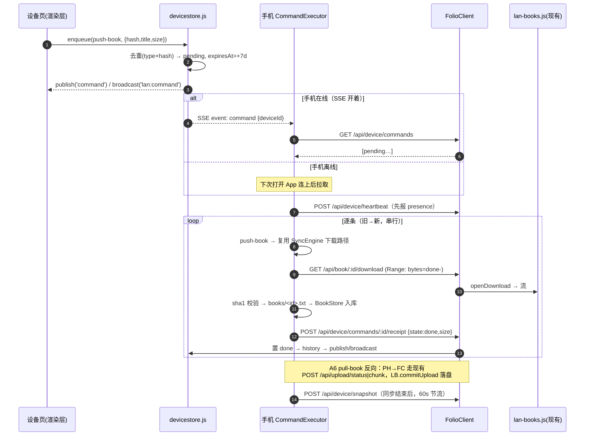

# 架构设计 · 桌面端「管理我的手机」

> 基线：桌面端 2.6.0 + Android 3.0.0 → 本期桌面端 **2.7.0**、Android **3.1.0**
> 需求基线：`docs/prd-device-manager.md`；接口风格与常量延续 `docs/arch-android-v3.md`
> 硬前提：无推送、无后台、指令只在"手机打开 App 且连上"时执行；传输全部复用 2.6.0 的 `/api/upload/*` 与 `/api/book/:id/download`。

---

## 1. 设备身份方案

### 1.1 installId 生成与持久化（Android）

- `SettingsStore.installId`：首次发起任何带设备头的请求前懒生成 `UUID.randomUUID()`，写入 SharedPreferences（key `install_id`），**永不变更**；卸载重装即换新 → 桌面端视为新设备。
- `deviceName`：`Build.MODEL`（不可编辑，重装不变），随头 `X-Folio-Device-Name` 上送。桌面端改名只改 `devices.json`，手机不改。
- 所有 `FolioClient.open()` 统一追加两个头（`installId` 为空则不带，保持与旧桌面端兼容）。

### 1.2 `devices.json`（桌面端，`dataDir/devices.json`）

```json
{ "devices": [{
  "id": "uuid", "name": "Pixel 8", "platform": "android",
  "appVersion": "3.1.0", "apiVersion": 2,
  "firstSeenAt": 0, "lastSeenAt": 0, "lastIp": "192.168.1.23",
  "lost": false,
  "snapshot": { "books": [{"hash","title","size","hasLocalFile"}],
                "storageTotal": 0, "storageFree": 0, "booksBytes": 0, "snapshotAt": 0 },
  "commands": [ { "id","type","payload","batchId?","createdAt","expiresAt","state",
                  "deliveredAt?","finishedAt?","error?" } ],
  "history":  [ /* 最近 50 条 done/failed/expired/cancelled */ ]
}]}
```

- **落盘裁剪**：`online`、SSE 计数是纯内存态，落盘前剔除；`commands` 只存未完结（pending/delivered），完结即移入 `history`（裁到 50 条）。
- **上限 5 条**：新增第 6 条时按 `lastSeenAt` 淘汰最旧且非在线的；淘汰前若是同名不同 id → 标 `lost:true` 而不删（"已失联"）。
- **`lost` 派生**：`!online && now - lastSeenAt > 30 天`（读时计算，不必落盘落值）。
- **安全**：不存访问码、不存手机本地路径、不存 IP 以外的位置信息。

### 1.3 `online` 派生（两条信号合并）

| 信号 | 来源 | 语义 |
| --- | --- | --- |
| **设备 SSE 打开** | 手机前台持有 `/api/events` 长连接（带 `X-Folio-Device` 头） | 强在线：断开即离线 |
| **SSE 显式关闭** | 最后一根同设备 SSE 断开（计数 1→0） | **强离线**：覆盖下面 90s 窗口 |
| **90s 活跃窗口** | 任意带设备头的认证请求 touch `lastSeenAt` | 弱在线：给「从没开过 SSE 的老客户端」兜底 |

- `online = deviceSseCount(id) > 0 || (now - offlineAt(id) > 90_000 && now - lastSeenAt ≤ 90_000)`。
- **为什么显式关闭要压过 90s 窗口**：手机只在前台开 SSE，最后一根断开会等价于「App 已经不在前台」。如果这时还靠 90s 窗口报在线，设备页会显示「手机在线」，用户对着已经锁屏的手机发指令、等一个永远不会执行的队列 —— 这正是 PRD §6 禁掉的误导文案。实现上 `noteSseClose(id)` 记一个纯内存 `offlineAt[id]`（**不落盘**），`upsertSeen(id)` 时清掉它（下一次心跳说明 App 还活着，在线态自动恢复）。
- **SSE 断开清在线态**：改造 `handleEvents` —— `clients` 从 `Set<res>` 改为 `Map<res, deviceId|null>`（浏览器面板为 null）。`cleanup()` 时同设备计数归 0 → 立即重算 online 并 `publish('device',{id,online:false})` + 主进程 `broadcast('lan:device')`。这就是 PRD 要求补的"连接/断开事件"：SSE 打开（0→1）发 `device online:true`，最后一个断开发 `online:false`。
- `stop()` 时必须对每个 owner 补 `noteSseClose`，否则服务重启后 SSE 计数残留，设备会永远显示在线。
- 手机端 SSE 只在前台且已连接时打开（`DeviceChannel`，lifecycle 感知），退后台即断——**不是后台任务**，App 一死连接就没了，离线态自然出现。

### 1.4 版本兼容

- **`apiVersion` 保持 2**：设备头与新增接口均为增量、不破坏旧语义。
- **`features` 追加 `'devices'`**。兼容表现：
  - 旧手机 + 新桌面：请求不带设备头 → 桌面端不建设备记录、不进指令队列，一切照旧。
  - 新手机 + 旧桌面：`features` 无 `devices` → 手机设置页显示"桌面端版本过旧，设备管理不可用"，不发心跳；心跳误发得到 404 也静默降级。
  - 新手机 + 新桌面但队列接口 404：视为"不支持"，不重试。

---

## 2. 指令队列协议

### 2.1 接口表（手机走 HTTP，渲染层走 IPC —— 桌面 UI 不走 LAN HTTP）

| 通道 | 方法 | 路径 | 参数/请求体 | 成功响应 | 错误码 |
| --- | --- | --- | --- | --- | --- |
| HTTP | POST | `/api/device/heartbeat` | 头 `X-Folio-Device(-Name)` | `{ok,device:{id,name,online},pending:2,serverTime}` | 400 无设备头；401 |
| HTTP | POST | `/api/device/snapshot` | `{books:[{hash,title,size,hasLocalFile}],storageTotal,storageFree,booksBytes,appVersion,apiVersion}` | `{ok,snapshotAt,accepted:true}` | 400 快照 >256KB 或格式错 |
| HTTP | GET | `/api/device/commands` | 头同上；读时先做过期清扫 | `{ok,commands:[{id,type,payload,batchId,createdAt,expiresAt}]}`（只回 pending，按 createdAt 升序） | 401 |
| HTTP | POST | `/api/device/commands/:id/receipt` | `{state:"done"\|"failed",error?,detail?}` | `{ok,state}` | 404 指令不存在或已过期；400 state 非法 |
| HTTP（桌面侧入队经 IPC，无 HTTP） | — | `devices:enqueue {deviceId,type,payload,batchId?}` | 返回 `{ok,command,duplicate?}` | — |
| IPC | `devices:list` / `devices:rename {id,name}` / `devices:remove {id}` / `devices:cancel {deviceId,commandId}` / `devices:clear {deviceId}` / `devices:retry {deviceId,commandId}` | — | 见文件清单 | — |

- 鉴权：沿用 `authorized()`；设备头缺失的请求能过鉴权但**不建记录、不回指令**。
- 大小限制：snapshot body ≤ 256KB（`readBody` 现有 512KB 够用）；指令 payload ≤ 4KB。
- 入队即广播：`publish('command',{deviceId,commandId})`（手机若在线会立刻拉取）+ `broadcast('lan:command')`。

### 2.2 指令类型

| type | payload | 执行方 | 数据通道（复用） |
| --- | --- | --- | --- |
| `push-book` | `{hash,title,size}` | 手机 | 手机先 `GET /api/library` 按 hash 反查桌面 id，再走现有 `GET /api/book/:id/download`（Range 续传） |
| `remove-book` | `{hash,title,unique:boolean}` | 手机 | 本地删除（`unique=true` 必须手机端二次确认） |
| `pull-book` | `{hash,title,size}` | 手机 | 手机走现有 `POST /api/upload/status|chunk`，桌面端 `commitUpload` 落盘 |

**`push-book` 的 id 反查**：payload 里只有 `hash`，而下载接口要的是桌面端 `book.id`。手机收到指令后先拉一次 `/api/library`（几十 KB）按 `contentHash` 反查 id；查不到说明桌面端确实已经没有这份副本 → 回执 `source_gone`。**不要为此给 payload 加字段** —— 那会让协议和桌面端 2.6.0 的清单语义分叉，而一次清单快照的成本远低于双端兼容成本。

**没有第四种类型**：A3 补齐 = 一次入队 N 条 `push-book`（带同一 `batchId`），单批 ≤50 本 / ≤2GB，超出直接拒绝（"单批最多 50 本 / 2GB，请分批"），不做批量指令类型。

---

## 3. 指令与现有同步的合流（指令只是触发器）



**要点**：指令只携带"做什么"，不携带字节；文件传输 100% 走 2.6.0 既有分块协议，双端代码零新增传输逻辑。`remove-book` 与 `pull-book` 的幂等性由 hash 保证（手机已没有该书 / 已有同 hash → 回执 done 而非失败）。

---

## 4. 快照上报

- **时机（三处，全部串行在既有流程尾部，不开新连接、不轮询）**：连接成功后（heartbeat 之后）、`SyncEngine.align()` 结束后、退出阅读器时。
- **节流**：手机侧内存记 `lastSnapshotAt`，间隔 < 60s 直接跳过；桌面侧 30s 内重复快照仅更新 `lastSeenAt`。
- **不与同步拉锯**：snapshot 是 `align()` 返回后的同协程下一步，`Connection: close` 短连接，绝不与分块上传/下载并发；SSE 长连接只承载事件不承载快照。
- 快照只含摘要（hash/title/size/hasLocalFile），**不含正文、不含手机路径**；单本只算一次。

---

## 5. 指令状态机

```
pending ──手机GET领取──▶ delivered ──回执done──▶ done
   │                        │
   │到期(懒判/清扫)          │回执failed(reason)
   ▼                        ▼
expired                   failed ──桌面端"重试"──▶ pending(新expiresAt)
   │                        │
   └──"一键重发"──▶ pending  └─delivered 超1h无回执──▶ pending(幂等重执行)
pending ──桌面端取消/清空──▶ cancelled(仅history)
```

| 规则 | 定义 |
| --- | --- |
| 去重 | 入队时同 `type + payload.hash` 已有 pending → 不新增，只刷 `createdAt/expiresAt`，响应带 `duplicate:true` |
| 寿命 | `expiresAt = createdAt + 7d`；读路径与手机领取前惰性清扫，`devices:list` 亦触发；**绝不静默重发** |
| 重试 | 仅用户点按（单条重试/重发按钮），生成新的 `createdAt/expiresAt` |
| 幂等 | push-book 已有同 hash → 直接回执 done；remove-book 手机已无此书 → done；pull-book 桌面已有同 hash → done |

**失败原因枚举（回执 `error` 值 ↔ 桌面端红点文案，逐字）**

| error | 桌面端显示文案 |
| --- | --- |
| `insufficient_space` | 手机空间不足，需要腾出 {X} MB |
| `too_large` | 超过 30MiB 上限，这本书只能留在本机 |
| `hash_mismatch` | 内容校验失败，传输不完整，已丢弃 |
| `network_interrupted` | 传输中断，可重试 |
| `user_rejected` | 你在手机上拒绝了这次操作 |
| `source_gone` | 对端已没有这本书的副本 |
| `unsupported` | 手机端版本太旧，不支持这条指令 |

---

## 6. 桌面端 UI（克制，不引状态库）

- **位置**：`SettingsPage.jsx` 的 `SECTIONS` 追加 `{ key:'devices', label:'我的手机', Icon: IconPhone }`，新组件 `src/components/DevicesPanel.jsx`（SettingsPage 本身已懒加载，不再单独 lazy）。书架右键的"发送到手机"走同一 `devices:enqueue`。
- **只靠 `online` 一个布尔切换两套呈现，不写第二套组件**：

| 区块 | 在线 | 离线 |
| --- | --- | --- |
| 状态条 | 绿点 · `手机在线 · {name} · {lastIp} · v{appVersion}` | 灰点 · `手机离线 · 上次在线 {相对时间}（MM-dd HH:mm）`；**禁词：正在同步/已同步到手机** |
| 书架 | 快照列表 + 差异标记：`桌面端没有这本书` / `两端内容不一致`（用本地 `library()` 对比快照 hash） | 整块置灰 + `{N} 天前的快照，可能已过期` 角标 |
| 存储 | `总容量 / 可用 / 书籍占用 / 快照时间` | 置灰 + 角标 |
| 动作 | 立即入队并提示已下发 | 入队 + `待执行 · 手机连接后自动执行，7 天内有效`；"刷新快照"按钮禁用（标"需要手机在线"） |
| 队列 | `待执行 N 项` 折叠区：单条取消、失败红点+原因、单条重试、清空 | 同左，另显示 `最早一条 {时间}` |

- **6 个动作入口与确认**：A1 设备页"发送到手机"+书架右键（无确认）；A2 书条目"移除"（桌面端二次确认：`把《xxx》从手机上删掉？电脑上的副本不受影响。`；`unique=true` 加红字 `手机上是唯一副本，手机端会再问你一次。`）；A3 主按钮"补齐差集"（确认清单 N 本与总量，勾选 `我知道会占用约 XX MB` 后才可点）；A4 存储卡（只读）；A5 队列折叠区（无确认，清空需确认）；A6 书条目"拉到电脑"（无确认）。

---

## 7. 文件清单

| 端 | 动作 | 路径 | 职责 |
| --- | --- | --- | --- |
| 桌面 | 新增 | `electron/devicestore.js` | devices.json 读写、设备 upsert/上限/lost、指令 enqueue/去重/领取/回执/清扫/history、online 派生 |
| 桌面 | 修改 | `electron/lan.js` | 设备头解析、`clients` 改 Map 带deviceId、SSE 连接/断开 `device` 事件、4 条手机端路由、`features+='devices'` |
| 桌面 | 修改 | `electron/main.js` | 注入 devicestore 适配器、7 个 IPC handler、`broadcast('lan:device'/'lan:command')` |
| 桌面 | 修改 | `electron/preload.cjs` | 暴露 `devices.*` 与事件订阅 |
| 桌面 | 新增 | `src/components/DevicesPanel.jsx` | 设备页全部 UI（两态切换、动作、队列） |
| 桌面 | 修改 | `src/components/SettingsPage.jsx` | SECTIONS 加 devices；挂载 DevicesPanel |
| 桌面 | 修改 | `src/components/Bookshelf.jsx` | 右键菜单"发送到手机"（本地书才显示） |
| 桌面 | 修改 | `src/store/AppStore.jsx` | devices action + 事件桥接 |
| 桌面 | 修改 | `package.json`/lock/`README.md`/`CHANGELOG.md` | 2.7.0（verify-release 校 lockfile 与 README） |
| 桌面 | 修改 | `tools/_lan-fixture.mjs` | 夹具带设备头能力 |
| 桌面 | 新增 | `tools/_device-check.mjs` | 模拟手机客户端全流程自查（心跳/快照/拉指令/回执/过期/去重） |
| Android | 修改 | `data/SettingsStore.kt` | `installId`（UUID 懒生成持久化）、`deviceName` |
| Android | 修改 | `net/FolioClient.kt` | 统一设备头；`heartbeat/fetchCommands/postReceipt/postSnapshot/openEvents`（SSE 读循环） |
| Android | 新增 | `data/DeviceChannel.kt` | 前台 SSE 生命周期（lifecycle 感知）、command 事件→触发拉取 |
| Android | 新增 | `data/CommandExecutor.kt` | 逐条执行三类指令，复用 SyncEngine 下载/上传路径；失败原因枚举 |
| Android | 修改 | `data/SyncEngine.kt` | align 结束回调 → 快照上报（60s 节流）+ pending 检查 |
| Android | 修改 | `ui/ShelfScreen.kt`（或新 `ui/DeviceConfirmDialog.kt`） | `remove-book unique=true` 全局确认弹层（文案逐字） |
| Android | 修改 | `app/build.gradle.kts` | 3.1.0 / versionCode 3 |
| Android | 新增 | `test/.../CommandExecutorTest.kt`、`DeviceHeadersTest.kt`、`SnapshotThrottleTest.kt` | 单测（无真机） |
| Android | 修改 | `test/.../LanIntegrationTest.kt` | 用夹具跑设备流端到端（模拟客户端） |

---

## 8. 任务列表

| ID | 依赖 | 任务 | 改哪里 / 做成什么样 / 怎么验证 |
| --- | --- | --- | --- |
| T01 | — | 设备存储与指令队列内核 | `electron/devicestore.js`：upsert(带设备头的请求自动建档)、上限5/lost、`enqueue`(type+hash 去重、batchId、7d)、`claim`/`receipt`/`sweep`/`retry`/`cancel`/`clear`、history 裁 50、`onlineOf(id)`。验：node 脚本对临时目录跑全状态机，断言过期、去重、幂等 |
| T02 | #1 | 手机端 HTTP 接口 + 在线派生 | `electron/lan.js`：`clients` 改 `Map<res,deviceId>`，SSE 0→1/→0 发 `device` 事件；90s 窗口合并；新增 heartbeat/snapshot/commands/receipt 四路由；`features` 加 `devices`；无设备头请求零影响。验：`curl` 带/不带 `X-Folio-Device` 各打一遍，断言建档与否与 online 翻转 |
| T03 | #2 | 渲染层通道 | `electron/main.js` 注入适配器 + `devices:list/rename/remove/enqueue/cancel/clear/retry` IPC；`preload.cjs` 暴露；`broadcast('lan:device'/'lan:command')`。验：DevTools 里 `window.readerAPI.devices.list()` 返回与 devices.json 一致 |
| T04 | #3 | 设备页 UI | `src/components/DevicesPanel.jsx` + `SettingsPage.jsx` SECTIONS：两态呈现（禁词"正在同步"）、书架快照 + 差异标记（对比本地 `library()`）、存储卡、6 动作与确认文案、队列折叠区。验：`npm run dev` 手测在线/离线文案与禁用态；验收第 1 条逐字核对 |
| T05 | #4 | 书架右键发送到手机 | `Bookshelf.jsx` 本地书右键"发送到手机"→ `devices:enqueue(push-book)`；云端书不显示该项。验：右键入队后设备页队列 +1 且去重生效 |
| T06 | #2,#3 | 版本与夹具自查 | `package.json`/lock/README→2.7.0、CHANGELOG；`tools/_lan-fixture.mjs` 支持设备头；`tools/_device-check.mjs` 模拟手机：心跳→快照→入队→领取→回执 done/failed→过期→重试→重装新 id→旧记录 lost。验：`node tools/_device-check.mjs /tmp/x` 全绿；`npm run check` 通过 |
| T07 | — | Android 设备身份与客户端 | `SettingsStore` installId/deviceName；`FolioClient` 统一头 + `heartbeat/fetchCommands/postReceipt/postSnapshot/openEvents`（SSE 行解析）；旧桌面 404 静默降级。验：`DeviceHeadersTest` 断言头存在与格式；单测覆盖 SSE 事件解析 |
| T08 | #7 | 指令执行器 | `data/CommandExecutor.kt`：push→复用下载（Range 续传 + sha1）、remove→unique 弹确认/拒绝回执、pull→复用上传；幂等（已有同 hash 回 done）；失败原因枚举逐字。验：`CommandExecutorTest` 用内存假 client 跑三类指令 + 五种失败原因 |
| T09 | #7 | 前台在线通道 | `data/DeviceChannel.kt`：ON_START 开 SSE、ON_STOP 关闭、command 事件→拉取执行；`ConnectionManager` 挂 heartbeat 与生命周期。验：单测模拟 lifecycle 翻转断言连接/断开次数；夹具端断言设备 online 跟随 |
| T10 | #8 | 快照上报 | `SyncEngine` align 结束回调 + `SnapshotThrottle`（60s）；快照体构建（仅摘要）。验：`SnapshotThrottleTest`；夹具端断言 60s 内第二次被跳过 |
| T11 | #8 | 独有副本删除确认 | `ui/DeviceConfirmDialog.kt`（全局弹层）：`remove-book unique=true` 时文案 `把《xxx》从手机上删掉？…` + 红字；确认→删文件+库+进度→回执 done；拒绝→回执 `user_rejected`。验：单测两分支；`LanIntegrationTest` 断言桌面端看到"用户拒绝" |
| T12 | #6,#9,#10,#11 | 端到端（夹具模拟，无真机） | `LanIntegrationTest` 扩展：起夹具→心跳→入队 push→模拟手机领取→downloadBook→回执 done→快照→过期用例（把 expiresAt 注入过去）→验收 2/3/4/5/6/8 逐条断言。验：`gradle test` 全绿 |
| T13 | #12 | 文档收尾 | `CHANGELOG.md`（双端 2.7.0 / 3.1.0）、`docs/android.md` 补设备章节、`docs/architecture.md` 接口表同步。验：`npm run check` 与 `gradle test` 通过 |

---

## 9. 待明确事项

1. **A3 补齐的并发上限**：一次 50 本串行拉完可能 20 分钟以上，手机端期间必须保持前台（SSE 断了就停）。要不要在手机端给"批量执行中"一个可取消的进度页（P2 里有"队列暂停/限速"）？当前设计：串行逐条 + 每条独立回执，中途断网已完成的不回滚。
2. **`delivered` 卡死恢复窗口（1h）**：手机执行完但回执没送到（崩溃/断网）时，指令 1 小时后回 `pending` 幂等重执行。若嫌激进可改 24h，只是 UI 上"执行中"会挂更久。
3. **旧记录"已失联"判定**：当前 `lost = 30 天未见`，重装新 id 同名时旧记录立即标 lost。若产品希望"重装当天就能看到旧记录标失联"，需要手机名+型号模糊匹配（PRD 第 8.3 问），成本更高，本期不做。
